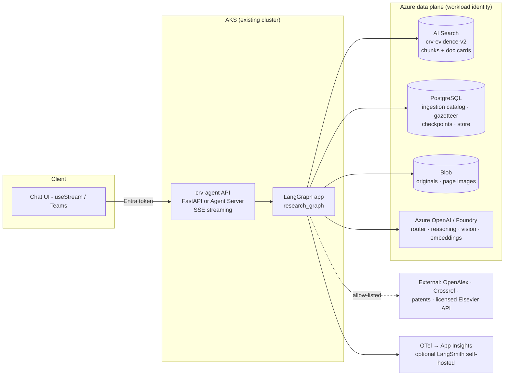
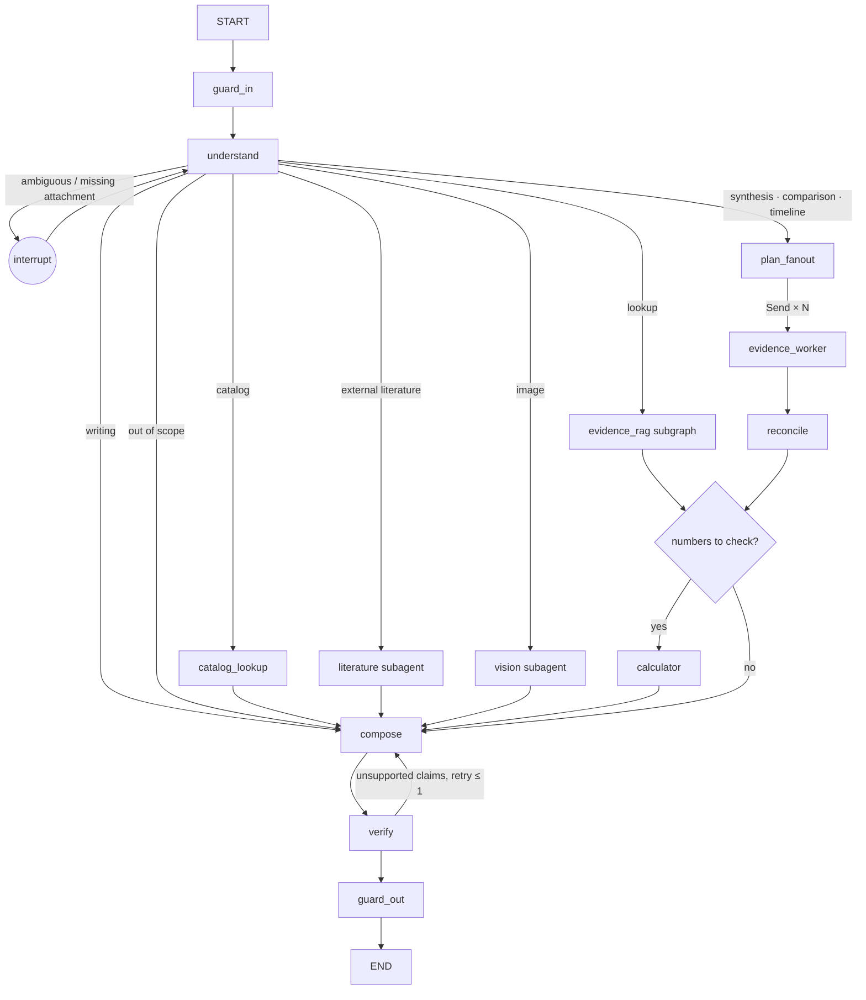

# CRV Research Assistant — Agentic Layer Architecture (proposal)

Status: **development backend implemented; broader architecture remains a proposal**.
[src/backend](../src/backend) implements bounded research orchestration, owned
PostgreSQL conversation persistence, verified-answer SSE, KG/Search retrieval,
deterministic calculations and CRV evaluation. Runtime versions are LangChain
1.4.5, LangGraph 1.2.15 and langchain-core 1.6.10, resolved from the available
package feed. The version discussion below records the original proposal.

The implementation uses the existing `crv-evidence-v1` schema, not the proposed
v2/doc-card index. KG-2 scientific-result extraction, external literature,
vision, uploads and cross-thread memory are not implemented. Evidence ACLs
are explicitly deferred; authentication/owned threads do not authorize corpus
access for shared deployment. No public ingress or production promotion is included.
Paid live evaluation and reviewed expected-source mappings remain release gates.

Implemented retrieval follows the
[measured baseline](evaluation/golden-retrieval-baseline-2026-10-21.md):
50 semantic-hybrid candidates per leg, soft periodic-summary (+10 positions)
and third/later-document-chunk (+20) penalties. Each facet exposes all 50 focused
candidates as full chunks, the measured winner in
[agent-retrieval-depth-2026-10-21](evaluation/agent-retrieval-depth-2026-10-21.md).
Bounded full reads remain for truncated chunks.
Secondary-summary labels are filename-derived, matching
the baseline heuristic; the runtime does not require a new KG metadata migration.
Evidence records the exact character spans shown to the model; only those spans
can ground claims or reach the verifier. Multi-part questions are decomposed
into at most six facets within a shared, measured-usage turn budget.
KG steering is a boost, never a corpus-wide restriction: Site, ReportCode and
approved Organisation only, with broad entity navigation retained for catalogue
requests. Document hashes are identical between KG and Search, including converted
PDF hashes; `converted_from` records original lineage, not a remapping requirement.
No overall quality improvement is claimed without live agent evaluation.
Expert-proposed expected sources remain unconfirmed review candidates.
End-to-end answer results (dev split), the retrieve-then-extract worker and the answer
contract (claims selected by number, number grounding, verbatim pruning) are in
[agent-answers-2026-10-21](evaluation/agent-answers-2026-10-21.md).

The proposal builds on the ingestion pipeline in
[src/ingestion](../src/ingestion) and the `crv-evidence-v1` index
([crv-evidence-index.json](../infra/search/crv-evidence-index.json)).
Stack: LangGraph 1.2 / LangChain 1.4 on Azure (Azure OpenAI via Foundry, Azure AI Search,
Azure Database for PostgreSQL, AKS).

---

## 1. What the Golden QA actually demands

[QA_REMINEX.xlsx](QA_REMINEX.xlsx) has two sheets:

* **Sheet1, 24 use-case types.** This sheet holds user needs with frequency and
  criticality. It covers more than corpus Q&A.
* **Sheet2, 76 golden questions.** Each question comes with expected answer elements.
  All of them are grounded in `Geometallurgy Cu\…\Dossier Cu` (186 files).

### 1.1 Sheet2: 76 golden questions by required behaviour

Numbering: `Q n` = Excel row − 1.

| Cat. | Behaviour required | Questions | # | Architectural consequence |
|---|---|---|---|---|
| A | Precise fact lookup (numbers, units, report codes, sample IDs) | Q1–Q30, Q71–Q76 | 36 | Hybrid + identifier search, page-level citations, duplicate awareness ("les deux fichiers sont identiques": Q4, Q14, Q18) |
| B | Multi-document synthesis / timeline ("retrace", "synthétise", lab → pilot → industrial) | Q31–Q43, Q53 | 14 | Planned fan-out per site/period/scale, evidence ledger, chronological ordering by **document date** |
| C | Cross-site comparison / corpus-wide enumeration (Work Index, partners, techniques, DMS, gold routes) | Q44, Q46–Q51, Q67–Q69 | 10 | Corpus "scan" over document cards (not top-k chunks), structured extraction to tables, **unit normalisation** (kWh/t vs kWh/sht, Q46) |
| D | Conflict / version / scope awareness | Q45, Q54, Q57–Q59, Q66 | 6 | Never merge divergent values; date each value; prefer final report; flag scope differences (cost mine→cathode vs reagents only) |
| E | Document catalogue / provenance (versions, duplicates, cover-only file, "which docs belong to…") | Q52, Q55, Q56, Q70 | 4 | Answered from the **ingestion catalog/manifest** (hashes, lineage, versions), not from chunk text |
| F | Abstention / false premise (2025 price, final CAPEX, lithium tests, "2022 pilot report") | Q60–Q63 | 4 | Sufficiency gate + premise verification + explicit "not in corpus" with what was searched |
| G | Arithmetic verification (mass balance, implied recovery) | Q64, Q65 | 2 | Deterministic calculator tool; the LLM never does arithmetic |

About half the set (B–G, 40/76) **cannot be passed by a plain retrieve-then-generate RAG**,
so the design needs explicit planning, parallel evidence gathering, reconciliation and
verification.

### 1.2 Sheet1: 24 use-case types to capabilities

| Capability | Sheet1 rows | Corpus support today |
|---|---|---|
| Internal evidence Q&A, data reuse, archive location | 12, 13, 25 (project status) | Good for Cu/Tizert; weekly reports exist for Tizert only |
| Expert advisory grounded in corpus (test interpretation, reagent choice, flowsheet, DOE, scale-up) | 2, 3, 4, 15, 20, 21, 22 | Partial; must separate **corpus evidence** from **general domain knowledge** |
| External literature / scientific watch / patents / benchmark / maps | 7, 8, 9, 10, 11 | None internal → external tools + scheduled watch |
| Procedures, standards, regulation | 16, 17, 24 | Weak: `Les normes_` and `Système QSE_` are empty; `Procédue_` has 3 files |
| Image analysis (froth, SEM) | 5, 6 | Needs multimodal model; low criticality |
| Cost estimation | 14 (**bloquant**) | No purchasing DB in dataroom → connector needed, otherwise abstain |
| Writing / translation | 23 | No retrieval needed |
| Out of domain (template residue: longitudinal stats, cohort, DPO) | 18, 19 | Remove from golden set or rewrite |

**Safety-critical:** row 24 (cyanidation protocol and PPE, *bloquant*). Answers must quote
an internal referenced procedure or refuse. They must never synthesise a safety procedure.

### 1.3 Golden-set quality notes (to fix before using it as a gate)

* Sheet2 lacks **expected source documents**, which source-match metrics need. Add `expected_sources` per question.
* Expected answers are prose. Split them into **atomic key facts** so each fact can be scored.
* Coverage gap: no golden questions cover GED `Documents Activité` (1,060 files, 18 GB), Phytoremediation/EIE, HSC, Veille, or LIMS. Add questions for those collections.
* Sheet1 rows 6, 17–19 have no frequency/criticality. Row 16's expected answer is a generic ISO list with no corpus support.

---

## 2. What the dataset implies

Corpus inventory: 1,967 files, ~24.5 GB. 1,913 PDF (3 of them LIMS), 24 DOC, 23 PPT, 1 DOCX, 1 ZIP of 197 MB.
There are also 5 empty `Readme.md` placeholders.

| Observation (verified in `Data\DATAROOM CRV`) | Impact on the agent |
|---|---|
| Heavy duplication: `+`-encoded copies, `(2)`, `.doc` + `.pdf` pairs, `V1`/`V2`/`VF`/"corrigée"/"provisoire", the same report in `MAA` and `Autres` | Collapse identical `content_hash` hits into one citation with "also filed at…"; model **version families** with a final-version preference |
| Folder ≠ content: `MAA` = Tizert (+ Alous, Amane N'Tazart); `SOMIFER` holds Bleida / Jbel Laasel / Jbel Nzourk; `CMO` = Oumjrane (+ Rich Merzoug, Boukerzia); `AGM` = Akka, Agoujgal, Tazalakht, Tasrirt, Sidi Ali | Path-derived `site_ids` in [crv.py](../src/ingestion/ingest_pipeline/domain/crv.py) are too coarse → **entity gazetteer** with deposit → site → company aliases and spelling variants (Ouansimi/Ouanssimi, Laasel/Laassel/Laasal) |
| 1995 → 2025 time span; dates live in filenames (`-05-2011`, `181215`, `260924`, `2019-11`) and cover pages | Index has **no document date**. Timelines (B) and "date each value" (Q45) need `document_date` + `date_basis` |
| Cover-only stubs (e.g. `CR-AR-OJ-RP-23-14.doc`, Q56) | `is_stub` flag (word count / page count) |
| Scanned historical reports, 2-column articles, value-heavy tables | Keep layout/OCR route; enable table observations for comparison questions |
| FR-dominant with EN vendor reports (ALS, Metso, MINTEK, TOMRA) and articles | The index already has `content_fr`/`content_en` analyzers. Answer in the user's language and keep original-language quotes |
| LIMS folder = commercial proposals/contracts only | Hard guard: never present LIMS documents as measured results |
| Serving is disabled (`and false` in [crv-knowledge-source.json](../infra/search/crv-knowledge-source.json)) until caller-aware ACLs exist | ACL trimming is a **precondition** for the agent (see §6) |

### 2.1 Ingestion/index enrichments required by the agent (prerequisites)

1. `document_date`, `date_basis` (`printed` | `filename` | `path`), `period` facet.
2. `version_group_id`, `version_label` (provisoire/V1/V2/final), `is_final_candidate`, `is_stub`.
3. **Document cards.** One record per logical document (title, date, sites/deposits, scale lab/pilot/industrial, type, 10-line abstract, key figures with page refs), in the same index (`chunk_kind = "doc_card"`) or a sibling index. These cards feed catalogue, comparison and timeline questions.
4. `entities` (sites, deposits, minerals, reagents, partners) normalised through the gazetteer, kept as *reported* tags. They are not certified facts.
5. Existing opt-in scientific observations (table cells with units) exposed through a read API for numeric comparisons.

---

## 3. Platform choices (verified against current docs)

Versions checked on PyPI (Oct 2026). Existing pipeline Python 3.11/3.12 is compatible.

| Package | Version | Use |
|---|---|---|
| `langgraph` | 1.2.16 | Orchestration runtime (StateGraph, Send/Command, interrupts, durable execution) |
| `langchain` / `langchain-core` | 1.4.6 / 1.6.12 | `create_agent` + middleware for bounded sub-agents; structured output |
| `langgraph-checkpoint-postgres` | 3.2.0 | `AsyncPostgresSaver` (threads) + `PostgresStore` (long-term memory) |
| `langchain-openai` / `langchain-azure-ai` | 1.7.2 / 1.2.10 | Azure OpenAI / Foundry chat models (`init_chat_model("azure_openai:…")`) |
| `azure-search-documents` | 12.0.0 (REST `2026-04-01` GA) | Retrieval tool (direct SDK, see below) |
| `langsmith` (+`[otel]`), `openevals`, `agentevals` | 0.14.11, 0.2.0, 0.0.9 | Evaluation / tracing |
| `deepagents` | 0.7.28 | Phase 3 only: long-running "state-of-the-art / watch" reports |

Decisions driven by current guidance:

* **Graph API for the top level, `create_agent` for leaves.** LangChain v1 makes `create_agent`
  the standard agent ([v1 release](https://docs.langchain.com/oss/python/releases/langchain-v1))
  and recommends dropping to LangGraph "when the agent loop isn't the right shape"
  ([Deep Agents FAQ](https://docs.langchain.com/oss/python/deepagents/overview)). The golden
  set needs deterministic gates (sufficiency, reconciliation, verification, abstention), so the
  outer flow is an explicit `StateGraph`. Bounded ReAct workers (external literature, vision)
  use `create_agent` with middleware.
* **Do not use `langgraph-supervisor`.** The docs mark it "no longer actively maintained" and
  recommend the **subagents pattern** (tool-wrapped workers under `create_agent`)
  ([migration guide](https://docs.langchain.com/oss/python/migrate/langgraph-supervisor)).
  Only the outermost graph gets a checkpointer.
* **Map-reduce with `Send`** for fan-out and **`Command`** for routing plus state updates
  ([Graph API](https://docs.langchain.com/oss/python/langgraph/use-graph-api)).
* **Agentic-RAG loop** follows the official pattern: query-or-respond → grade documents →
  rewrite → generate ([custom RAG agent](https://docs.langchain.com/oss/python/langgraph/agentic-rag)).
  The current docs have no hallucination-check node, so this design adds an explicit
  **verify** node.
* **Middleware** (all built-in, [prebuilt middleware](https://docs.langchain.com/oss/python/langchain/middleware/built-in)):
  `ToolErrorMiddleware` + `ToolRetryMiddleware`, `ModelRetryMiddleware`, `ModelFallbackMiddleware`,
  `ModelCallLimitMiddleware`, `ToolCallLimitMiddleware`, `SummarizationMiddleware`, `PIIMiddleware`,
  `HumanInTheLoopMiddleware`, `ContextEditingMiddleware`.
* **Durability:** per-node `RetryPolicy` and `timeout`, `CachePolicy` on search nodes,
  `recursion_limit`, `AsyncPostgresSaver` ([fault tolerance](https://docs.langchain.com/oss/python/langgraph/fault-tolerance),
  [persistence](https://docs.langchain.com/oss/python/langgraph/persistence)).
* **Retrieval: direct Azure AI Search SDK instead of the knowledge-base `retrieve` action.**
  - In the GA `2026-04-01` API, `retrieve` supports only `intents` with minimal extractive retrieval. Query planning and answer synthesis are preview-only (`2026-08-01-preview`).
  - `retrieve` ignores index scoring profiles ([MS Learn](https://learn.microsoft.com/en-us/azure/search/agentic-retrieval-how-to-retrieve)).
  - The LangChain Azure AI Search retriever lives in `langchain-community`, outside the first-party Azure provider page.
  - A thin custom `@tool` over `azure-search-documents` gives full control of filters, ACL trimming, identifier boosting and dedup.
  - Keep the knowledge-base MCP endpoint for later Foundry IQ interoperability.
* **Knowledge graph:** an evidence-linked domain KG in a new `crv_kg` schema, projected to
  Apache AGE on the same PostgreSQL server ([design](./KNOWLEDGE_GRAPH_DESIGN.md)). The agent reaches it only through parameterised tools
  and never cites it directly. The full rationale and the A/B gate are in §8.
* **MCP:** use the built-in `langchain.mcp.MCPAdapter` (`langchain[mcp]`, ≥1.4) for external
  connectors. The standalone `langchain-mcp-adapters` package is superseded
  ([migration](https://docs.langchain.com/oss/python/migrate/langchain-mcp-adapters)).

---

## 4. Target architecture



### 4.1 The research graph



| Node | Kind | Responsibility | Model tier |
|---|---|---|---|
| `guard_in` | function | Size limits, prompt-shield / injection screen, PII middleware, attachment typing | — |
| `understand` | LLM, structured output (`QueryPlan`) | Intent (A–G + advisory / external / image / writing / out-of-scope), language, entities **resolved through the gazetteer** (`resolve_entities`, MAA→Tizert, etc.), time window, **premises to verify** (catches Q63's "2022 pilot report", via `find_studies` + search), sub-questions, criticality | fast |
| `clarify` | `interrupt()` | "Cet essai?" with no attachment or project context → ask the user; resume with `Command(resume=…)` | — |
| `evidence_rag` | subgraph | Hybrid search → grade (structured) → rewrite (≤ 2 loops) → **sufficiency check** → `abstain` flag | fast |
| `plan_fanout` | LLM | Split into facets (per site / deposit / period / scale), and select **doc cards** first (plus `find_studies` / `find_precedents` when the KG is enabled, §8) so coverage does not depend on chunk top-k | reasoning |
| `evidence_worker` | `Send` target | For one facet, search chunks inside the selected documents and return typed `Claim`s (value, unit, sample/ore, scale, date, citation) | fast |
| `reconcile` | function + LLM | Dedup by `content_hash`/version family, prefer final reports, **detect conflicts** (same quantity, different value/date/scope), normalise units via `pint` | reasoning |
| `catalog_lookup` | tool (SQL read functions) | Versions, duplicates, stubs, lineage (`document_lineage`, KG Tier 1), "documents of phase X" from the ingestion catalog/manifest | — |
| `calculator` | tool | Safe expression and unit arithmetic over cited inputs (Q64, Q65) | — |
| `literature` | `create_agent` subagent | OpenAlex/Crossref/patents tools; DOI validation; output labelled **external** | fast |
| `vision` | `create_agent` subagent | Froth/SEM image commentary + retrieval of similar internal cases; output labelled advisory | vision |
| `compose` | LLM, structured output (`Answer`) | Sections, claims[] → citation ids, conflicts[], assumptions[], provenance labels (corpus / external / general knowledge) | reasoning |
| `verify` | LLM judge + deterministic checks | Every cited chunk entails its claim; every number appears verbatim (or derives from the calculator); citations in ACL scope; abstention justified | fast |
| `guard_out` | function | Safety policies (cyanide/PPE → internal procedure or refusal), LIMS guard, "bloquant" topics → disclaimer or optional expert review interrupt | — |

### 4.2 State (sketch)

```python
from typing import Annotated, Literal, TypedDict
from langgraph.graph import MessagesState
from operator import add

class Citation(TypedDict):
    cid: str                 # stable "S1", "S2" for the answer
    projection_id: str
    source_uri: str
    pages: list[int]
    content_hash: str
    also_filed_at: list[str] # duplicates collapsed by content_hash
    document_date: str | None
    version_label: str | None

class Claim(TypedDict):
    text: str
    quantity: str | None
    value: str | None        # raw string, never re-formatted by the LLM
    unit: str | None
    scope: str | None        # e.g. "mine->cathode" vs "reactifs seulement"
    subject: str             # site / deposit / sample id (gazetteer id)
    date: str | None
    cids: list[str]

class ResearchState(MessagesState):
    plan: dict                               # QueryPlan
    principal: dict                          # oid, groups (from token; never LLM-editable)
    evidence: Annotated[list[Citation], add] # reducer: parallel workers append
    claims: Annotated[list[Claim], add]
    conflicts: list[dict]
    calc_results: list[dict]
    answer: dict | None                      # Answer (structured)
    verification: dict | None
    budget: dict                             # tool/model call counters
```

Rules: `principal` and search filters are injected through **runtime context**
(`context_schema`) and are not part of model-editable state. Parallel workers only write to
reducer-backed keys.

### 4.3 Retrieval tool contract (`search_evidence`)

* **Query:** hybrid search. BM25 over `content`, `content_fr`, `content_en`, `title`, `identifiers`, `document_code`, plus vector search through the index's integrated vectorizer (3,072-d `text-embedding-3-large`), then the semantic ranker.
* **Identifier fast path:** when the question contains a report code (`REPORT_CODE` regex from `crv.py`, e.g. `CR-AR-PE-01-15`, `KM5962`), the tool filters or boosts on `document_code`/`identifiers` first. Q3 relies on this, because CR-AR-PE-01-15 and -02-15 must not be confused.
* **Filters:** built server-side as `release_id` ∧ ACL(principal) ∧ validated facets (site/deposit via gazetteer, `collection`, `document_type`, `period`, `chunk_kind`). The LLM can *propose* facets, but they are checked against facet whitelists. **It can never remove ACL or release clauses.**
* **Post-processing:**
  - Collapse identical `content_hash` hits into one citation with `also_filed_at`.
  - Mark `is_stub`.
  - Attach `document_date`/`version_label`.
  - Cap the token budget per call.
  - Return `EvidenceChunk` objects with stable ids.
* **Caching:** `CachePolicy` keyed by (query, filters, ACL hash, release).

### 4.4 Answer policy (from Sheet2 expectations)

* Every factual sentence carries ≥ 1 citation (document title, date, original page).
* **Conflicts are shown, not resolved silently.** For Q45, Q54 and Q57 the answer shows both values, each with its date and source, and states which source is preferred and why (final report > presentation > draft).
* **Different samples are not merged.** Q58 (Amensif) and Q59 (Nzourk) involve different samples and scales, and the answer must say so.
* **Units are kept as printed.** When a comparison mixes units, the answer flags it (Q46).
* **Abstention template:** "Information absente du corpus" + what was searched + the closest related evidence (Q60–Q63). False premises are corrected explicitly.
* **Provenance labels:** *Corpus CRV* vs *Littérature externe* vs *Connaissances générales (non sourcées)*. Advisory answers (Sheet1 rows 2–4, 20–22) must keep these labels apart.

---

## 5. Memory, runtime and deployment

* **Short-term:** `AsyncPostgresSaver` on the existing Azure PostgreSQL, in a separate `agent` schema/database. Use uuid7 `thread_id`s; the docs note a 255-character limit. Only the outer graph is checkpointed.
* **Long-term:** `PostgresStore` namespaced `(user_oid, "prefs")` and `(user_oid, "projects")` for language, default sites and the current project context (Sheet1 row 12 "mon projet"). Do not store retrieved restricted content in long-term memory.
* **Runtime options:**
  1. **Recommended:** a FastAPI service on the existing AKS cluster that hosts the compiled graph, exposes SSE streaming (`stream_events` / `stream(mode=["messages","updates","custom"])`), uses workload identity, and is benchmarked by the existing [agent-benchmark](../infra/kubernetes/agent-benchmark) job against `backend.crv.svc`.
  2. **Alternative:** **LangSmith Deployment / Agent Server** (self-hosted standalone server with `langgraph.json`). It provides threads, runs, crons, the task queue and `useStream` compatibility, but requires an Enterprise licence and stores data in its own Postgres/Redis.
* **Scheduled watch** (Sheet1 rows 8, 10, 11, weekly): a K8s CronJob or Agent Server cron runs a Deep Agents–based "veille" job. That job uses planning + subagents + filesystem to write a digest document, and does not handle chat turns.
* **Streaming UX:** custom stream events report progress ("12 rapports SOMIFER analysés…") to keep TTFT within the existing gate (p95 ≤ 25 s).

---

## 6. Security, safety and governance

* **Identity propagation:**
  - The user's Entra token is validated at the API.
  - The agent's search identity is a managed identity with *Search Index Data Reader*.
  - Per-request ACL filters come from the user's groups (`acl_groups`, `access_scope_id`). Alternatively, use Search's native permission filtering once validated.
  - This satisfies README acceptance check 7 and lets the knowledge source drop `and false`.
* **Prompt injection:** retrieved documents are data, never instructions. Tool outputs are wrapped and delimited, and external web/literature content passes through a separate summariser before it reaches `compose`.
* **External egress:** external calls go only to allow-listed connectors. Queries sent to external APIs must not contain internal confidential content (site names and figures are stripped unless a policy allows them).
* **Safety-critical topics:** for cyanidation, PPE and hazardous reagents, `guard_out` requires an internal procedure citation or refuses. `HumanInTheLoopMiddleware` and interrupts are available for "bloquant" outputs (cost estimates, Sheet1 row 14).
* **Observability:** OpenTelemetry (the pipeline already has an [otel adapter](../src/ingestion/ingest_pipeline/adapters/telemetry/otel.py)) exports to Application Insights with GenAI semantic conventions. LangSmith tracing is used only if self-hosted or approved for this data (`LANGSMITH_OTEL_ENABLED`). Prompts, retrieved text and user content follow the same data-handling policy as the corpus.

---

## 7. Evaluation and promotion gates

1. Convert Sheet2 to `golden/crv_golden.jsonl`. Each record holds `id`, `question`, `category` (A–G), `key_facts[]` (atomic), `expected_sources[]`, `must_abstain`, `must_flag_conflict`, `numeric_checks[]` (value ± tolerance, unit), and `split` (dev/heldout, stratified by category).
2. Evaluators (LangSmith experiments or the existing in-cluster benchmark):
   - **Key-fact recall:** LLM judge per atomic fact (`openevals`).
   - **Numeric exactness:** deterministic.
   - **Citation validity:** deterministic. Each cited chunk exists, is in ACL scope, and contains the value.
   - **Source match:** expected document or any of its duplicates/versions counts as a hit.
   - **Abstention accuracy:** F set.
   - **Conflict flagging:** D set.
   - **Trajectory checks** (`agentevals`, subset mode): Q64/Q65 must call `calculator`; E questions must call `catalog_lookup`; F questions must not answer without a sufficiency pass.
   - **Latency and cost.**
3. Extend [gates.json](../infra/kubernetes/agent-benchmark/gates.json) with CRV-specific gates. Suggested starting values:

| Metric | Gate |
|---|---|
| `key_fact_recall` (A) | ≥ 0.80 |
| `key_fact_recall` (B, C) | ≥ 0.60 |
| `numeric_exact_rate` | ≥ 0.90 |
| `invalid_citation_answers` | = 0 |
| `abstention_accuracy` (F) | = 1.0 |
| `conflict_flag_rate` (D) | ≥ 0.80 |
| `source_match_rate` | ≥ 0.80 |
| `first_token_seconds_p95` | ≤ 25 |

4. Online: thumbs/comments in the UI feed back into the dataset. Failing production traces become new golden candidates after expert review.

---

## 8. Knowledge graph (ontology): decision

**Verdict: yes, a targeted, evidence-linked domain KG built incrementally, used as a
*navigation and reconciliation layer* for the agent. No to an ontology-first programme and no
to an auto-extracted "GraphRAG" community graph.** Answers and citations always come from text
chunks; the graph tells the agent *where to look, what belongs together, and what disagrees*.

### 8.1 Why (golden set + corpus)

| Category | # | KG value | What the graph contributes |
|---|---|---|---|
| A: fact lookup | 36 | Low | Entity resolution (aliases, spelling variants) and duplicate collapse only; hybrid search already answers these |
| B: synthesis / timeline | 14 | **High** | Complete study spine per deposit/process (lab → mini-pilot → pilot → industrial, dated), so coverage does not depend on top-k |
| C: comparison / enumeration | 10 | **High** | "All studies on X", "all reagents tested on Y": an exhaustive list is a query, not a retrieval guess |
| D: conflict / version / scope | 6 | **High** | Results stored as n-ary observations (value, unit, basis, sample, date, scale) make Q45 / Q46 / Q54 / Q58 / Q59 / Q66 conflicts *detectable* rather than hoped-for |
| E: catalogue / provenance | 4 | **High** | `VERSION_OF`, `DUPLICATE_OF`, `SUPERSEDES`, `PART_OF` lineage (Q52, Q55, Q56, Q70) |
| F: abstention / false premise | 4 | Medium | Premise check ("2022 Tizert pilot" → no such campaign); absence in a curated graph is only a *signal*, confirmed by search |
| G: arithmetic | 2 | Medium | Typed value + unit inputs for the calculator |

About **34 / 76** questions (categories B–E) get high value. In Sheet1, rows 12, 21 and 22 benefit most: "has a
similar ore / mineral / reagent been tested internally?" is a graph traversal. The corpus has
exactly that shape: the same deposits (Hajar, Tighardine, Koudiat Aicha, Agoujgal, Jbel Laasel,
Amensif, Pumpi…) recur in reports from 1994 to 2018, scattered across folders where
**folder ≠ site** (MAA, SOMIFER, CMO, AGM, CMG, RDC), under spelling variants and heavy duplication.

Literature is consistent with this split. A systematic evaluation finds RAG and GraphRAG
complementary, with RAG stronger on single-hop detail and graph methods stronger on multi-hop or
aggregate questions ([arXiv 2502.11371](https://arxiv.org/abs/2502.11371)). A 2026 benchmark
finds agentic search narrows the gap, but graph structure still helps complex multi-hop
reasoning and stabilises agent behaviour once its offline cost is amortised
([arXiv 2604.09666](https://arxiv.org/abs/2604.09666)). Hence the A/B gate in §8.6
rather than an up-front commitment.

**Why not an auto community graph (Microsoft-GraphRAG style):** LLM-extracted triples with no
review conflict with the evidence-first gates. The questions here are about *specific* studies,
values and versions, not global "themes". Re-indexing 1,967 documents (24.5 GB, OCR-heavy) is costly.

**Why not ontology-first (OWL, reasoning, upper ontologies):** the value lies in a few dozen
classes with good instance data, not in axioms. Reasoning adds maintenance and gives no golden-set lift.

### 8.2 Scope in three tiers (build in order; each is useful alone)

| Tier | Content | How it is built | Review |
|---|---|---|---|
| **1. Deterministic** | Document lineage (`VERSION_OF`, `DUPLICATE_OF` via `content_hash` / normalised title, `SUPERSEDES`, `PART_OF` for FS chapters, doc ↔ pdf pairs) + **gazetteer** (Organisation / Site / Deposit with `altLabel`s: MAA→Tizert, Laasel/Laassel/Laasal…) | Rules over the ingestion catalog + a curated seed list | Gazetteer owned by domain experts; lineage auto-`observed` |
| **2. Study spine** | `Study/Campaign` (scale, date, facility, partner such as MINTEK), `Sample/Material`, `Process`, `Deposit`, `Document` | LLM structured extraction from title, summary and first pages → `candidate` | Experts approve the high-traffic entities |
| **3. Results** | n-ary `Observation`: property, value *as printed*, unit, basis/scope, sample, study, evidence locator (page / table cell / span), status | Seeded from existing `ScientificObservation` table cells + LLM extraction | Stays `candidate` unless reviewed; always shown with its source |

### 8.3 Minimal ontology

Classes: `Organisation`, `Site`, `Deposit/Zone`, `Sample/Material`, `Mineral`, `Reagent` (with
role: collector, depressant, frother, lixiviant…), `Process/UnitOperation` (flotation, gravity,
leaching, cementation…), `Study/Campaign`, `Observation`, `Document` / `VersionFamily`,
`CharacterisationTechnique` (XRD, QEMSCAN, SEM…), `ProjectMilestone`.

Core relations: `operatedBy`, `locatedIn`, `sampledFrom`, `studies` (Study → Deposit / Sample /
Process), `usedReagent`, `performedBy` / `partner`, `reportedIn` (→ Document + locator),
`hasObservation`, `observedProperty`, `versionOf` / `supersedes` / `duplicateOf` / `partOf`.

Alignment is light, by IRI annotation only: PROV-O (provenance), SOSA/SSN (observations),
QUDT/UCUM (units; `pint` for conversion), SKOS (labels and aliases). Optionally ChEBI (reagents)
and Mindat (minerals). No OWL reasoning.

### 8.4 Storage: a CRV-native schema, reusing proven patterns

The detailed design, based on a corpus sample, is in [KNOWLEDGE_GRAPH_DESIGN.md](./KNOWLEDGE_GRAPH_DESIGN.md).

* The `kg.*` tables ([0011_kg_store.sql](../src/ingestion/ingest_pipeline/sql/0011_kg_store.sql)
  to [0013_kg_context.sql](../src/ingestion/ingest_pipeline/sql/0013_kg_context.sql)) come from a
  previous maintenance project. They use the `urn:tizert:` namespace, an Equipment / InstrumentTag
  vocabulary, and closed CHECK constraints. Tizert is also a real site in this corpus, so those
  names would be ambiguous.
* Create a new **`crv_kg`** schema and AGE graph **`crv_research`** with `urn:crv:` IRIs.
  Reuse only the governance *pattern*:
  - runs and entity records with `review_status`;
  - approved identifiers with decision ids;
  - evidence locators with `scope_key`;
  - assertions with status history;
  - releases projected to AGE, with a SQL fallback;
  - bounded read functions.

  Observations stay relational (n-ary).
* Graph engine: **Apache AGE on the existing Azure PostgreSQL Flexible Server** (PG16, per
  [postgresql-flexible-server.bicep](../infra/core/database/postgresql-flexible-server.bicep);
  AGE is a supported extension there). This means one database, one identity model, and one
  backup. Do not add Neo4j. Retire the Fuseki pilot ([fuseki-pilot.ttl](../infra/knowledge/fuseki-pilot.ttl))
  for this use case.
* ACL: every entity and assertion inherits the `scope_key`s of its evidence, and read functions
  take `p_scopes`. The graph can never reveal the *existence* of a restricted study.

### 8.5 How the agent uses it (LangGraph integration)

Parameterised, read-only tools over SQL functions, using a dedicated Entra-authenticated
`crv_kg_reader` role (same pattern as [kg_access.py](../src/ingestion/ingest_pipeline/adapters/postgres/kg_access.py)).
**No free-form text-to-Cypher.**

| Tool | Used by | Returns |
|---|---|---|
| `resolve_entities(text)` | `understand` | Canonical IRIs + aliases + ambiguity list (feeds `QueryPlan.entities`) |
| `find_studies(deposit?, process?, reagent?, scale?, period?)` | `plan_fanout`, `understand` (premise check) | Study list with document ids and status |
| `get_results(study? / deposit?, property)` | `reconcile`, `calculator` | Observations with value, unit, basis, locator |
| `find_precedents(material / mineral / reagent)` | `plan_fanout` (Sheet1 row 12 type) | Similar internal studies, ranked |
| `document_lineage(doc)` | `catalog_lookup`, `reconcile` | Version family, duplicates, superseding document |

**Graph-guided retrieval:** KG results yield document ids and locators. `evidence_worker` then
calls `search_evidence` filtered to those documents, so citations always come from text. The
answer shows each graph fact's review status ("candidate, unreviewed"), and `verify` rejects any
claim whose only support is a graph assertion.

### 8.6 Decide by measurement: A/B pilot on Dossier Cu

Every golden question is grounded in `Geometallurgy Cu\Week 22-06-2026\Dossier Cu` (186 files),
so the pilot can be small and complete:

1. Build Tiers 1–2 (and Tier 3 for the properties used in the golden set) for those 186 files only.
2. Run **variant A** (agentic RAG + document cards, P2 design) against **variant B** (A + KG tools)
   on the 76 questions.
3. Adopt the KG for the full corpus if B improves **B / C / D / E** by at least 10 points on
   key-fact recall or citation correctness and causes **no regression on A / F**, at an
   acceptable extraction-plus-review cost per document. Otherwise keep only Tier 1 (lineage +
   gazetteer), which pays for itself regardless.

### 8.7 Risks and mitigations

| Risk | Mitigation |
|---|---|
| Confidently wrong structured facts | Text-only citations; review status shown; `verify` rejects graph-only claims |
| Closed-world fallacy ("not in graph" ⇒ "doesn't exist") | Absence triggers a search confirmation before any F-type abstention |
| Ontology / curation burden | Small class set; expert review limited to high-traffic entities; Tier 1 is rule-based |
| OCR noise in old reports (1990s scans) | Extraction confidence threshold; values kept "as printed" with locator |
| PII (author names, signatories) | Do not model persons in v1; `PIIMiddleware` on outputs |
| Drift between index and graph | Graph built from the same ingestion catalog run ids; release pointer per environment |

---

## 9. Roadmap

| Phase | Scope | Exit criterion |
|---|---|---|
| **P0: prerequisites** | ACL enforcement; index v2 fields (date, version family, stub, entities); gazetteer table; golden JSONL + evaluator harness; baseline on plain hybrid RAG | Baseline numbers per category |
| **P1: core graph** | `guard_in` → `understand` → `evidence_rag` → `compose` → `verify` → `guard_out`; `catalog_lookup`, `calculator`; abstention; streaming API on AKS; **KG Tier 1** (lineage + gazetteer in `crv_kg` under `urn:crv:`, `resolve_entities`, `document_lineage`) | Gates met for A, E, F, G |
| **P2: research fan-out** | Document cards; `plan_fanout` / `evidence_worker` (`Send`) / `reconcile`; conflict & unit handling; project memory; **KG Tiers 2–3 on Dossier Cu + A/B (§8.6)** | Gates met for B, C, D; KG adopt / limit-to-Tier-1 decision |
| **P3: beyond corpus** | Literature subagent (OpenAlex / Crossref / patents / licensed Elsevier), scheduled watch (Deep Agents), vision subagent, writing mode | Golden set extended to Sheet1 types; expert acceptance |
| **P4: expert loop** | HITL review for *bloquant* outputs, purchasing-DB connector (cost), procedure library ingestion (normes / QSE folders currently empty) | Domain sign-off on safety-critical categories |

### Open decisions

1. Runtime: self-managed FastAPI on AKS vs LangSmith Deployment (licence, data residency).
2. Model tiers: run the existing bake-off approach against the golden set to pick the fast, reasoning and vision deployments in Foundry.
3. Whether LangSmith (self-hosted) is approved for traces containing corpus text, or only App Insights.
4. Ownership of the gazetteer and of golden-set `expected_sources` (domain experts).
5. KG curation: who reviews `candidate` studies and observations, and at what throughput. Also,
   whether to drop the legacy `kg.*` / `tizert_pilot` objects from the CRV database (see
   [KNOWLEDGE_GRAPH_DESIGN.md](./KNOWLEDGE_GRAPH_DESIGN.md) §10).
