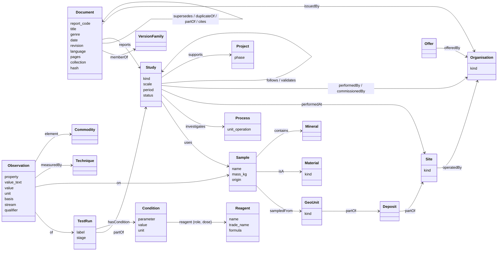
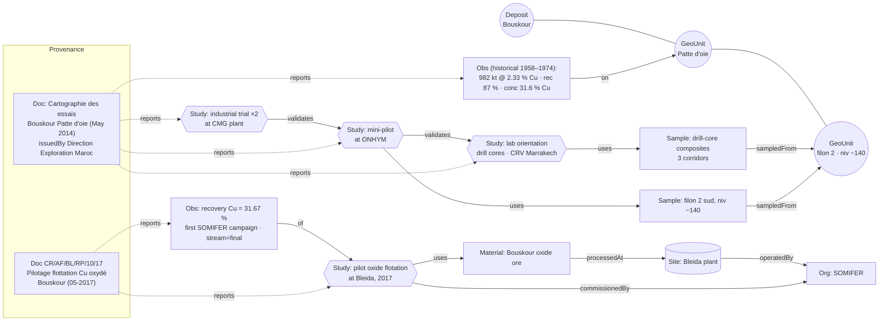
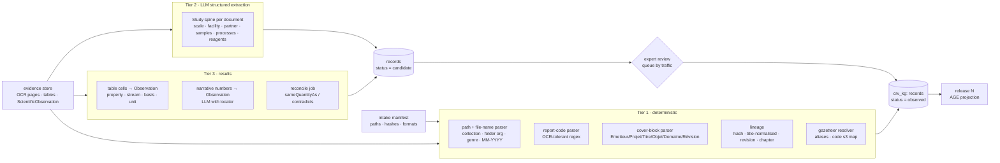

# CRV Research Knowledge Graph: design

Status: **KG-1 implemented** (deterministic tier, release `crvkg-20261021-a40f0b27792a` active
as `dev`); KG-0 seed is provisional and awaits expert review; KG-2 onwards is a proposal,
October 2026. Companion to [AGENTIC_ARCHITECTURE.md](./AGENTIC_ARCHITECTURE.md) §8,
which explains *why* a graph is worth building. This document says *what* to build, based on a
sample of the actual `Data\DATAROOM CRV` corpus.

> **Naming note.** `tizert_pilot`, `urn:tizert:`, `tizert_kg_reader` and the `TIZ_*` variables
> come from a previous (maintenance) project. In this corpus **Tizert is a real site**
> (MAA copper project), so reusing those names would be ambiguous. This design uses the `crv`
> namespace throughout and treats the old `kg.*` code only as a pattern library.

---

## 1. What the corpus sample shows

### 1.1 Method

* Text layer of pages 1–2 of **all 1,913 PDFs** (PyMuPDF, no OCR): text-layer coverage, cover
  fields, report codes.
* Full first pages of **62 PDFs**, stratified by leaf folder (1–2 per folder), read manually.
* Cross-check against the 76 golden answers in `Docs\QA_REMINEX.xlsx`.

These are sample findings, not certification of extraction quality.

### 1.2 Collections are heterogeneous

| Collection | Files | Content | Graph relevance |
|---|---|---|---|
| `Geometallurgy Cu\…\Dossier Cu` (AGM, Bouskour, CMG, CMO, MAA, Ouansimi, SOMIFER, Autres) | 186 | Cu test reports, pilot campaigns, feasibility chapters, weekly project reports, PPT | **Core**: all 76 golden questions |
| `Augmentation AI Processus R&D\GED_ A alimenter\Documents Activité` (AKKA-AGM, BLEIDA, BOU-AZZER, BOUSKOUR, CMG, CTT Hydro, GABON, GUINEE, OUMJRANE, RDC, SAMINE, SMI, SOUDAN, CENTRE DE RECHERCHE CRV…) | ~1,040 | Lab/pilot reports 1994–2025 across Cu, Co, Au, Ag, Zn/Pb, fluorite, black mass, effluents | **Core**: precedents, timelines |
| `Documents R&D`, `Documents Veille`, `Documents Externes` | ~440 | Monthly activity reports, commodity benchmarks, partner/vendor missions, offers | Context, partners, offers |
| `Documents QSE - RSE`, `Procédue_ A alimenter` | ~127 | Safety committees, training, procedures (`CR-AR-I-01.00-05 Rév.5`) | Safety policy lookups only |
| `Phytoremediation` | 68 | EIE chapters and annexures (Tizert, Trik, GGM, Bouskour), Bou-Azzer geology, flora data | **Environment module** (optional) |
| `HSC Doc`, `Bibliothèque numérique` | ~78 | Software manual, textbooks | Out of graph (search only) |
| `LIMS` | 3 | Commercial documents | Out of graph |

### 1.3 Stable structure to exploit deterministically

| Signal | Coverage measured | Example |
|---|---|---|
| **Date in GED file names** `… - MM-YYYY-.pdf` | 1,587 / 1,621 GED files (98%) | `Rapport de pilotage de flottation du minerai de Jbel Laasel- 05-2014-.pdf` |
| **Genre = first word of the file name** | rapport 812, pv 78, etude 67, executive (summary) 66, synthèse 57, compte (rendu) 52, proposition 33, revue 25, bilan 24, pilotage 20, caractérisation 19, mission 17, diagnostic 11, prédiction 10, offre 10, flash 7, veille 7 | `Proposition …`, `PV de la réunion du …` |
| **CRV report code** `CR/<s2>/<s3>/<type>/<seq>/<yy>` | 412 PDFs before OCR (OCR will raise this). Types: RP 405, PV 15 | `CR/AR/MC/RP/24/10`, `CR/AF/BL/RP/10/17`, `CR/AR/BM/RP/13/24` |
| **Standard cover block** (`Emetteur, Projet, Titre, Objet, Domaine d'application, Révision, Rédaction, Vérification, Approbation/Décision, Attribué à, Copié à, Mots-clés, Textes de référence`) | ≥ 4 fields found in 315 PDFs before OCR; the template is in `Templates des Livrables\Rapport CRV.pdf` | Pumpi 2010, Oumjrane 2011, Tri-K 2020, black mass 2024 |
| **Revision history table** (`Révision / Date / Pages / Modification`) | Same reports | `0 · 15/03/2024 · Création` |
| **Revision suffixes in file names** | EIE chapters `_R0/_R1/_R2_<ddmmyyyy>` | `Chapter 10_E … _14122021_R2.pdf` |
| **Text layer** | 982 / 1,913 PDFs (51%) have > 200 chars on p1–2; the rest need the pipeline's OCR route | 1990s–2000s scans (`Bou-Azzer 2008`, `CMG 2007`) |

**Report-code segment 3 is a project/site/theme code.** Candidate meanings, inferred from the
folders where each code appears (the experts must confirm them):

| Code | Folders | Candidate meaning | Code | Folders | Candidate meaning |
|---|---|---|---|---|---|
| `TZ` | MAA 10, AKKA-AGM 8 | Tizert | `BL` | BLEIDA 11, SOMIFER 6 | Bleida |
| `BA` | BOU-AZZER 11 | Bou-Azzer | `IM` | SMI 34 | Imiter (SMI) |
| `CJ` | CMO, OUMJRANE | Oumjrane | `CB` | Bouskour 7 | Bouskour |
| `JL` | BLEIDA, SOMIFER | Jbel Laasel | `AG` | AKKA-AGM, AGM | AGM / Akka (Tazalakht) |
| `CG` | CMG 9 | CMG Guemassa | `BM` | CTT Hydro 21 | Black mass |
| `IN` | SOUDAN 26, GUINEE 11 | International | `TR` | GUINEE, Documents R&D | Tri-K |
| `MC`, `CP` | RDC | Pumpi / Managem Congo | `SM` | SAMINE | Samine |
| `EN` | CMG, AGM, Bou-Azzer | Environment | `TC` | CRV centre 15 | Technical activity reports |
| `MS`, `FM`, `PY`, `CO`, `PE`, `OE`, `OS`, `DB`, `DM`, `BC`, `CL` | various | **unknown, to be confirmed** | | | |

Segment 2 (`AR` 269, `AF` 139, `AC` 14) looks like a department or activity type. Its meaning is unknown.

### 1.4 Entities and facts that recur in the text

From the sampled documents (examples quoted from the reports):

| Kind | Examples in the corpus |
|---|---|
| Organisations / sites | REMINEX (Centre de Recherche, site de Hajar/Guemassa), Managem, CMG, SOMIFER, SMI, AGM, CMO, MAA, SMM (Tri-K), Samine, ONHYM, MINTEK, ALS Metallurgy, Metso Outotec, AECI, Axis House, Bond Equipment, Metallica (USA), Glencore, CHEMAF |
| Geology hierarchy | Bouskour → zone *Patte d'oie* → *filon 1/2* → *niveau −140*, *colonne sud*; Ouansimi *structure OUEST / Centrale*, *niveau −350 m*; Tizert zones *Sud, Nord-Centre, Aferni*; SOMIFER *Amas 3* |
| Materials | Composite of drill cores (*sondages carottés / percutants*), *carrière B*, *digue* (tailings dam), *haldes*, *scorie*, *TV / tout-venant*, *cément*, black mass, hydroxides, effluent, *matière secondaire*; ore types *oxydé / sulfuré / mixte*; named samples such as *Tizert Master Composite 1 (114 kg, 0.97% Cu)* |
| Mineralogy | XRD tables: quartz, dolomite, calcite, talc, clinochlore (with formula, density, hardness, magnetism); chalcopyrite, pyrite, pyrrhotite, arsenopyrite |
| Process | Flotation stages (*ébauchage, épuisement, relavage 1–3*), DMS, WHIMS magnetic separation, heap/agitated/column leaching, bio-leaching, cyanidation (CIL), SX (ACORGA M5397, LIX 984), electrowinning, detalcing |
| Reagents with role and dose | Na₂S₂O₅ 300 g/t (pyrite depressant, pH 11); AXK 90 g/t (collector); DLQ5 30 g/t; Na₂S 1,000 g/t (sulfidiser); NaHS 200 g/t; Sendep 150 / 30D; hydroxamate AM810; NaClO₃ |
| Scale and facility | Lab orientation → mini-pilot (ONHYM) → pilot campaign (1st, 2nd) → industrial trial at CMG / AGM plants; plant monitoring (Bleida line 1 / line 34) |
| Results (n-ary) | Head assays (Cu t, Cu ox, oxidation rate, As, Ag ppm…); mass balance per product stream (concentrate, rougher, scavenger, tailings, feed) with weight %, grade, distribution; recovery; Work Index (kWh/t vs kWh/sht); acid consumption kg/t; resources (3,716 kt @ 1.52% Cu); costs (DH/kg Cu, scope-dependent); offers (500 kg, 1 month, 160,000 DH HT) |
| Historical facts | Bouskour mined 1958–1974: 982 kt @ 2.33% Cu, 87% recovery, concentrate 31.6% Cu |
| Cross-document links | "Les essais précédents (Rapport d'activité 12/2015)…", "première campagne réalisée par l'équipe de SOMIFER…", feasibility chapters (`4.Chapitre 4 (Hydrogéologie)`), EIE annexures A–V |
| People and roles | Author / verifier / approver / recipients on every cover. **Personal data**: see §8 |

### 1.5 Golden answers rely on exactly these shapes

* Q27 (Ouansimi): **reagent + dose + pH + ore structure + level → concentrate grade + recovery**.
* Q14: **external lab + report id (KM5962) + named sample + mineral deportment**.
* Q33: **pilot campaigns per year → zones, grind d80, recovery**, a timeline over Study nodes.
* Q38: **lab 2010 → ONHYM mini-pilot 2011 → 2 industrial campaigns at CMG**, a scale ladder.
* Q30: **plant performance per period** compared with a benchmark.
* Q20: **resource estimate with cut-off**. Q4: **offer terms**.
* Q45 / Q46 / Q54 / Q59 / Q66: the same quantity with a different value, unit, date, sample or
  scope. These are **conflicts that only n-ary observations can expose**.

---

## 2. Design principles

1. **Evidence first.** Every node and edge carries ≥ 1 evidence locator (document, page, table cell
   or text span). The agent cites text, never the graph.
2. **Deterministic before generative.** Path, file name, report code, cover block and hashes come
   first. LLM extraction is used only where no structure exists, and its output stays `candidate`
   until reviewed.
3. **As-printed values.** Store `value_text` exactly as printed plus the normalised value and unit.
   Never overwrite with a "corrected" number.
4. **Small vocabulary, open instances.** About 20 classes and controlled vocabularies (SKOS) for
   types. Adding a new reagent or deposit is data, not schema.
5. **Access follows evidence.** A node is visible only if at least one of its evidence locators is
   in the caller's scope.
6. **Releases.** The agent reads a frozen, versioned release. Extraction runs never change what
   the agent sees mid-conversation.

---

## 3. Ontology

### 3.1 Modules



| Module | Classes | Notes |
|---|---|---|
| **Provenance** | `Document`, `VersionFamily`, `ReportCode`, `Locator` | Genre, date, revision, issuer, cover fields. Aligned with PROV-O (`prov:Entity`, `prov:wasRevisionOf`) |
| **Actors and places** | `Organisation`, `Site`, `Deposit`, `GeoUnit`, `Project` | Fixes folder ≠ site. `GeoUnit` is recursive (zone ⊃ vein ⊃ level) |
| **Materials** | `Material` (type), `Sample` (instance), `Mineral`, `Commodity` | Sample names are scoped by study; `Material.kind` comes from the SKOS scheme |
| **Experimentation** | `Study` (campaign or report-level investigation), `TestRun`, `Condition`, `Process`, `Reagent`, `Technique` | `Study.scale` ∈ desk / lab-orientation / lab-optimisation / mini-pilot / pilot / industrial-trial / plant-monitoring |
| **Results** | `Observation` (n-ary) | SOSA `Observation` + QUDT unit; carries `basis` (dry/wet, kWh/t vs kWh/sht, per t TV, cost scope) and `stream` (feed, concentrate, tailings, rougher…) |
| **Business** | `Offer`, `CostEstimate` (a subclass of `Observation` with a mandatory `scope`), `ResourceEstimate` (with cut-off) | Covers Q4, Q6, Q20, Q66 |
| **Environment** (optional, phase 2) | `EnvironmentalStudy`, `SpecialistReport`, `SamplingPoint`, `Contaminant`, `Species` | Covers the Phytoremediation collection (EIE chapters and annexures) |

### 3.2 Relation catalogue

| Subject | Predicate | Object | Source | Corpus example |
|---|---|---|---|---|
| Document | `hasCode` | ReportCode | regex on cover or file name | `CR/AF/BL/RP/10/17` |
| Document | `issuedBy` | Organisation | cover `Emetteur` | Centre de Recherche REMINEX; Direction Exploration Maroc |
| Document | `aboutProject` | Project | cover `Projet` + code segment 3 | "Valorisation du cuivre d'Oumjrane" |
| Document | `memberOf` | VersionFamily | normalised title + code + hash | V1 / V2 / provisoire, `(2)`, `+`-encoded copies |
| Document | `supersedes` | Document | revision index / suffix `_R2` / date | EIE Tizert chapters R2 vs R0 |
| Document | `duplicateOf` | Document | identical `content_hash`, or doc ↔ pdf conversion pair | `CR-AF-CG-RP-34-10.doc(Amensif).doc` |
| Document | `partOf` | Document | chapter / annexure naming | `4.Chapitre 4 (Hydrogéologie)`, `Annexure U_Geochemical…` |
| Document | `cites` | Document | LLM + regex ("Rapport d'activité 12/2015") | Ouansimi RA 01/2016 → RA 12/2015 |
| Document | `reports` | Study | LLM (one report → 1..n studies) | Agoujgal + Tazalakht ×3 samples in `CR/AC/AF/RP/004/07` |
| Site | `operatedBy` | Organisation | gazetteer | Bleida → SOMIFER; Tizert → MAA |
| Deposit / GeoUnit | `partOf` | Deposit / Site | gazetteer + LLM | Patte d'oie → Bouskour; filon 2 → Patte d'oie |
| Material | `processedAt` | Site (plant) | LLM | Bouskour oxide ore → Bleida plant (4,000 t/month) |
| Sample | `sampledFrom` | GeoUnit / Deposit | LLM | Composite of drill cores → Agoujgal |
| Study | `uses` | Sample | LLM | Pilot → Tizert Master Composite 1 |
| Study | `investigates` | Process | LLM + SKOS | WHIMS magnetic separation (Pumpi 2010) |
| Study | `performedAt` / `performedBy` | Site / Organisation | LLM + gazetteer | ONHYM (mini-pilot), CMG plant (industrial trial) |
| Study | `commissionedBy` | Organisation | LLM | "Somifer a demandé l'appui du centre" |
| Study | `follows` / `validates` | Study | LLM, reviewed | Industrial trial validates pilot validates lab |
| TestRun | `hasCondition` | Condition | table / LLM | Na₂S₂O₅ 300 g/t, pH 11 |
| Condition | `reagent` (+`role`) | Reagent | LLM + reagent list | Na₂S₂O₅ as pyrite depressant |
| Observation | `of` / `on` / `property` / `stream` | TestRun / Sample / SKOS / SKOS | tables (`ScientificObservation`) + LLM | Concentrate 22% Cu, recovery 98% |
| Observation | `contradicts` / `sameQuantityAs` | Observation | computed in the reconcile job, reviewed | SOMIFER 18.5% (2020) vs 25.4% (2025) |
| Offer | `offeredBy` / `terms` | Organisation / Observation | LLM | `CR-AR-PE-01-15`: 500 kg, 1 month, 160,000 DH HT |

### 3.3 Controlled vocabularies (SKOS concept schemes)

| Scheme | Seed values (from the sample) |
|---|---|
| `genre` | report, synthesis report, pilot report, characterisation, mission report, PV / meeting minutes, activity report (monthly), executive summary, offer / proposal, benchmark / watch, procedure, feasibility chapter, EIE chapter / annexure, weekly project report, flash, presentation |
| `scale` | desk, lab-orientation, lab-optimisation, variability, mini-pilot, pilot, industrial-trial, plant-monitoring |
| `process` | crushing/grinding, flotation (rougher / scavenger / cleaner 1–3), DMS, gravity, WHIMS, leaching (agitated / heap / column / bio / oxidising), cyanidation / CIL, SX, EW, cementation, detalcing, roasting, filtration, decantation |
| `materialKind` | ore (oxide / sulphide / mixed), composite, tailings (digue), slag (scorie), halde, cement, concentrate, black mass, hydroxide, effluent, secondary material |
| `reagentRole` | collector, depressant, sulphidiser, frother, activator, pH modifier, dispersant, lixiviant, oxidant, extractant, flocculant |
| `property` | head grade, oxidation rate, recovery, concentrate grade, distribution, weight yield, Work Index, d80, acid consumption, reagent consumption, Cu/Fe ratio, resource tonnage, cost, mineral abundance |
| `basis` | dry / wet, per t TV, kWh/t vs kWh/sht, cost scope (mine → cathode, reagents only, OPEX/CAPEX), cut-off grade |
| `technique` | XRD, chemical assay, fire assay, QEMSCAN / MLA, SEM, optical microscopy, TCLP / EN 12457 |

Labels are FR and EN with `altLabel`s for variants (*Ouansimi / Ouanssimi / Ouasnimi*,
*Laasel / Laassel / Laasal*, *épuisement = scavenger*, *relavage = cleaner*, *TV = tout-venant*).
Units use QUDT/UCUM codes, converted with `pint`.

### 3.4 Identifiers

* `urn:crv:<class>:<slug>`, for example `urn:crv:deposit:bouskour`,
  `urn:crv:geounit:bouskour/patte-d-oie/filon-2`, `urn:crv:reagent:na2s2o5`.
* **Documents:** `urn:crv:doc:<sha256-prefix>` (content identity from the intake manifest). The
  report code is an identifier, not the key, because codes are reused across revisions and are OCR-noisy (`CRlARlMC`).
* **Samples and studies** are scoped by their parent:
  `urn:crv:study:<doc-hash>/<n>`, `urn:crv:sample:<study>/<slug>`. Cross-study identity
  ("same master composite") is a reviewed `sameAs` decision, never automatic.
* **Observations:** `urn:crv:obs:<hash(locator + property + stream)>`, which is stable across re-runs.

---

## 4. Worked example (from sampled documents)



The question "synthesise the Bouskour treatment studies that fed the feasibility study" (Q38) becomes:
1. Resolve `Bouskour`.
2. Traverse `Study -uses-> Sample -sampledFrom-> GeoUnit -partOf*-> Bouskour`, ordered by `scale` and date.
3. Pass the documents that report those studies to `search_evidence` for the text and citations.

---

## 5. Building the graph



| Step | Input | Output | Details |
|---|---|---|---|
| File-name parser | manifest relative path | genre, date (MM-YYYY), folder organisation, title | 98% date coverage in the GED. Dossier Cu needs cover / OCR for dates |
| Report-code parser | p1–2 text + file name | `ReportCode{s2,s3,type,seq,yy}` | Accept `/ - l` as separators (OCR); validate `yy` against the file-name year |
| Cover-block parser | OCR'd page 1 with layout key-values | issuer, project, title, purpose, scope, revision, dates, keywords | Template-driven (`Rapport CRV.pdf`); use Document Intelligence key-value pairs where available |
| Lineage | hashes, titles, codes, revisions | `duplicateOf`, `memberOf`, `supersedes`, `partOf` | Pure rules; no LLM |
| Gazetteer | curated seed list (experts) + aliases | canonical Org / Site / Deposit / GeoUnit IRIs | Seed from §1.3 code table and §1.4 entity list |
| Study extraction | cover + introduction + TOC + conclusion pages (≤ 6 pages) | `StudyExtraction` (Pydantic, below) | One call per document; `structured_output`; locator per field |
| Observation extraction | existing `ScientificObservation` table cells (+ header and footnote context) | `Observation` with property, stream, basis | Rules for mass-balance tables (rows = streams, columns = weight / grade / distribution); LLM for property mapping |
| Reconcile | observations grouped by (subject, property, stream) | `sameQuantityAs`, `contradicts` | Different value beyond tolerance after unit normalisation → `contradicts` candidate |

```python
class SampleRef(BaseModel):
    name: str                      # as printed
    origin: str | None             # deposit / zone / vein / level, as printed
    material_kind: MaterialKind | None
    mass_kg: float | None
    locator: Locator

class StudyExtraction(BaseModel):
    scale: Scale
    period: str | None             # as printed; normalised later
    facility: str | None           # "ONHYM", "usine CMG", "Centre de Recherche"
    commissioned_by: str | None
    partners: list[str]
    commodities: list[str]
    processes: list[ProcessType]
    samples: list[SampleRef]
    reagents: list[ReagentUse]     # name, role, dose_text, unit, locator
    follows_or_validates: list[str]  # cited prior work, as printed
    locator: Locator
```

Every extracted field carries a `Locator` (document hash, page, optional table cell or span). A
field without a locator is rejected.

---

## 6. Storage

* **Relational core in PostgreSQL** (the existing Flexible Server), new schema **`crv_kg`**:
  * `run`, `entity`, `entity_record` (with `review_status`: observed / candidate / approved / rejected / superseded), `identifier`, `alias`;
  * `evidence` (locator + `scope_key`), `assertion` + `assertion_status` + `assertion_evidence`;
  * `observation` (typed columns: `property`, `value_text`, `value_num`, `unit`, `basis`, `stream`, `qualifier`);
  * `release`, `release_member`.

  This reuses the *governance pattern* of the earlier `kg.*` tables, with CRV vocabularies and
  no `urn:tizert:` or maintenance CHECKs.
* **Graph projection:** Apache AGE graph **`crv_research`** built per release from approved and
  observed records (candidates are projected with a flag). The SQL fallback keeps the same functions.
* **Observations stay relational.** They are numerous and n-ary, so they are queried with SQL
  (filter, group, compare). Only their links (`of`, `on`, `property`) are projected to the graph.
* **Read access:** one Entra-authenticated role `crv_kg_reader` with `EXECUTE` on read functions only.

```sql
-- Example read function (shape only)
crv_kg.find_studies(p_release text, p_scopes text[],
                    p_entity text[] default null,    -- deposits / sites / samples (IRIs)
                    p_process text[] default null, p_reagent text[] default null,
                    p_scale text[] default null, p_from date default null, p_to date default null,
                    p_limit int default 50)
  returns table(study_iri text, scale text, period daterange, facility text,
                documents text[], status text, evidence jsonb);
```

```cypher
// Inside AGE (for traversal-heavy templates): precedents for a mineral problem
MATCH (s:Study)-[:USES]->(:Sample)-[:CONTAINS]->(m:Mineral {iri: $mineral}),
      (s)-[:INVESTIGATES]->(p:Process)
RETURN s.iri, s.scale, s.period, collect(DISTINCT p.label) LIMIT 50
```

---

## 7. Agent tools and golden-set coverage

The tools are read-only, parameterised and release-pinned, taking the caller's scopes. There is
no free-form text-to-Cypher. They plug into the nodes described in
[AGENTIC_ARCHITECTURE.md](./AGENTIC_ARCHITECTURE.md) §4.1 and §8.5.

| Tool | Backed by | Golden examples it serves |
|---|---|---|
| `resolve_entities(text)` | `alias`, `identifier` | All categories (Ouanssimi → Ouansimi, MAA → Tizert, JBL → Jbel Laasel) |
| `find_studies(entity, process, reagent, scale, period)` | `find_studies` SQL / AGE | Q32 (talc at Agoujgal, lab → plant), Q33 (Tizert pilots 2015–2024), Q38 (Bouskour filon II), Q39 (Ouansimi Cu/Fe selectivity), Q42 (CMG sommital) |
| `get_observations(subject, property, stream, basis)` | `observation` | Q23, Q25, Q27, Q30, Q64–Q65 (calculator inputs) |
| `compare_observations(property, subjects)` | `observation` + `contradicts` | Q45, Q46 (kWh/t vs kWh/sht), Q54 (1974 / 1977), Q58, Q59, Q66 (cost scope) |
| `find_precedents(mineral \| material \| reagent \| problem)` | AGE traversal | Sheet1 rows 12, 21, 22 ("tested internally before?") |
| `document_lineage(doc)` | lineage edges | Q52, Q55, Q56 (cover-only `.doc`), Q70 |
| `check_premise(entity, scale, year)` | `find_studies` (empty ⇒ search confirmation) | Q60–Q63 (non-existent "2022 Tizert pilot") |

Result contract: `{items[], documents[], locators[], status per item, release}`. `evidence_worker`
always fetches the cited text via `search_evidence` filtered to `documents[]`.

---

## 8. Quality, governance and personal data

* **Validation rules** (checked per run, as code, SHACL-style):
  * every record has ≥ 1 evidence locator;
  * `Observation.unit` is in the UCUM set or explicitly `null` with `value_text`;
  * `Study.scale` comes from the vocabulary;
  * a `CostEstimate` has a `scope`;
  * a document date lies between 1950 and the release date;
  * `supersedes` is acyclic.
* **Metrics per release:**
  * coverage: % of documents with date, genre, organisation, ≥ 1 study;
  * precision: stratified sample audit by experts (≥ 50 records per tier);
  * candidate backlog;
  * KG-tool contribution in the golden-set A/B ([AGENTIC_ARCHITECTURE.md](./AGENTIC_ARCHITECTURE.md) §8.6).
* **Review queue** ordered by query traffic and golden-set relevance. Approved decisions carry a
  `decision_id` and reviewer.
* **People:** covers name authors, verifiers, approvers and recipients. **v1 does not create
  Person nodes.** Names stay in the text index. An "expertise finder" (who worked on what) is a
  separate, opt-in module that needs data-protection approval.
* **ACL:** entities inherit `scope_key`s from evidence. The LIMS commercial documents and any
  restricted folders never contribute to shared nodes visible to other scopes.

---

## 9. Rollout

| Step | Scope | Exit criterion |
|---|---|---|
| **KG-0** | Gazetteer seed (orgs, sites, deposits, aliases, code segment 3 map) reviewed by experts; vocabularies v1 | Experts sign off the seed lists |
| **KG-1** | Tier 1 on the **whole corpus** (file names, codes, covers, lineage) | ≥ 95% of documents with genre + date; lineage audit precision ≥ 0.95 |
| **KG-2** | Tiers 2–3 on **Dossier Cu (186 files)**; tools wired into the agent | A/B on the 76 golden questions meets the §8.6 criteria |
| **KG-3** | Tiers 2–3 on `Documents Activité` (~1,040 files), prioritising Cu, then Co / Au / Ag | Precedent queries validated by experts on 20 real requests |
| **KG-4** | Environment module (Phytoremediation / EIE) | Use cases defined by the phytoremediation team |

### 9.1 KG-1 as implemented (2026-10-21)

- **Code:**
  - Pure builder in `ingest_pipeline/domain/crv_kg/`: file-name, report-code and cover parsers, the gazetteer, lineage, the run model and the projection.
  - Store and AGE loader in `adapters/postgres/crv_kg.py`; inputs in `adapters/postgres/crv_kg_inputs.py`.
  - Migrations `0015` (drop the copied Tizert `kg.*`), `0016` (`crv_kg` system of record + `CREATE EXTENSION age`) and `0017` (read API).
  - CLI: `kg-build`, `kg-release`, `kg-check`, `kg-gazetteer-sheet` and `kg-grant-reader`.
- **Inputs:**
  - Evidence documents of policy `crv-full-v1`, all source placements, page-header codes, and page-1/2 DI blocks.
  - DI key-value pairs are not stored, so cover fields are parsed from paragraph lines and table rows.
  - People on covers are never stored.
- **Scope:**
  - LIMS commercial documents and the reference collection (HSC manuals, digital library) are excluded.
  - Scope keys are one per collection (`crv:research`, `crv:geometallurgy`, `crv:environment`), plus `crv:gazetteer` for the seed.
- **Statuses:**
  - Facts read from a path, file name, cover or printed code are `observed`.
  - Anything resolved through the provisional gazetteer is `candidate` and released flagged. So are heuristic duplicates.
- **Release `crvkg-20261021-a40f0b27792a`:**
  - 1,848 documents and 4,313 vertices, including 1,725 report codes, 647 projects, 16 sites and 11 organisations.
  - 9,860 edges: 7,263 observed and 2,597 candidate.
  - AGE graph `crv_research_a40f0b27792a`.
- **Coverage (genre and date):** 97.1% overall.
  - research: 99.4%
  - geometallurgy: 89.5%
  - environment: 63.9% (most EIE annexes carry no date)
- **Cover parsing:** covers were parsed for 1,560 of 1,595 research documents, and the issuer was resolved on 1,090 documents.
- **Open items for review:**
  - The KG-0 seed: [crv-gazetteer-review.csv](./crv-gazetteer-review.csv) and §10.
  - A lineage audit sample.
  - 386 documents whose report-code year differs from the file-name date by more than a year. Possible causes are OCR noise in header codes or cited codes.

---

## 10. Open questions for the domain experts

1. Meaning of report-code segment 2 (`AR`, `AF`, `AC`) and of the unknown segment-3 codes (`MS`,
   `FM`, `PY`, `CO`, `PE`, `OE`, `OS`, `DB`, `DM`, `BC`, `CL`).
2. Canonical list of organisations, sites and deposits, and their parent/child relations (for
   example, is Tazalakht a deposit of AGM or a separate site?).
3. Which properties matter most for precedent search (recovery, grade, oxidation rate, Work Index,
   reagent consumption, cost)?
4. Who reviews `candidate` studies and observations, and at what weekly throughput?
5. Is an opt-in expertise finder (people ↔ topics) wanted, and under which data-protection rules?
6. Can the legacy `kg.*` tables, the `tizert_pilot` AGE graph and the Fuseki pilot from the
   previous project be dropped from the CRV database, or must they coexist?
